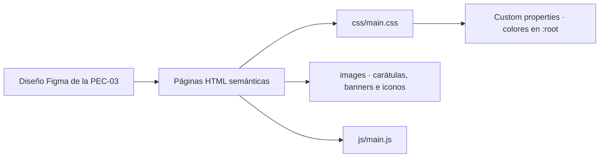
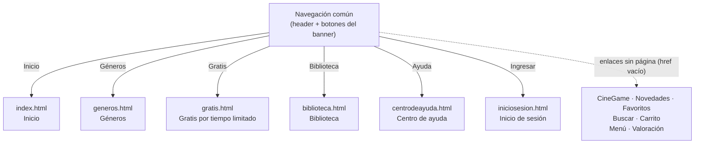

# Gameverse

Maquetación en HTML y CSS de **Gameverse**.

Esta es una web que funciona como tienda de videojuegos. Usé una variedad de imágenes como ejemplo de práctica.

Usé como referencia, para el diseño de la web, el ejemplo de la PEC-03, donde creé el diseño en Figma: [Ver diseño en Figma](https://www.figma.com/design/imBMytLTG3RjlJtIGJ9pIn/Johan-Sebasti%C3%A1n-Rodr%C3%ADguez-Osorio?node-id=0-1&t=gsfKSWzVIhm27nMo-1)

Usé HTML5, CSS3 (custom properties, Flexbox, Grid, scroll-snap), metodología BEM, unidades relativas (`rem`, `vw`, `%`) y diseño responsive.

## Arquitectura



## Páginas maquetadas

| Archivo | Página | Contenido |
|---|---|---|
| `index.html` | Inicio | Carruseles de juegos populares y de juegos más vendidos, con botones de comprar y añadir a la cesta. |
| `generos.html` | Géneros | Un carrusel por género: infantiles, acción y terror. |
| `gratis.html` | Gratis | Título "Gratis por tiempo limitado" y tres carruseles de carátulas. |
| `biblioteca.html` | Biblioteca | Tres columnas con los juegos divididos en Tus juegos, Más jugados y Favoritos; cada juego lleva un botón "Jugar". |
| `centrodeayuda.html` | Centro de ayuda | Formulario para enviar una incidencia (nombre, apellido, email, tipo de incidencia y detalle). |
| `iniciosesion.html` | Inicio de sesión | Formulario de email y contraseña, con los botones "Entrar" y "Crear" y un enlace "Olvidé mi contraseña". |

## Componentes creados

| Componente | Clases |
|---|---|
| Banner | `banner`, `banner__hero`, `banner__logo`, `banner__botones` |
| Menú de navegación | `header`, `header__nav`, `header__ul` |
| Carrusel | `div__carruseldecaratulas` |
| Tarjeta de juegos | `picture__caratulas`, `carruselboton` |
| Columnas de biblioteca | `main__biblioteca` |
| Formularios | `formulario`, `formulario__campo-de-texto`, `boton` |
| Footer | `footer`, `footer__div` |

## Cambios al diseño

- Cambié los enlaces del navegador, porque al separarlos se veían muy amontonados.
- Cambié, en la página de Biblioteca, el nombre del videojuego por un botón "Jugar".
- Cambié el Footer, para que no fuese tan sencillo: le agregué unos enlaces para brindar información, centré el texto "derechos reservados..." y cambié el nombre de las redes sociales por el logo de estas.
- Alineé los enlaces de (menú, valoración, ayuda, ingresar) hacia la esquina superior izquierda, para agregar el nombre de la web (Gameverse).
- Dejé el logo centrado, entre el título y los enlaces (menú, valoración, ayuda, ingresar).
- Añadí la página de Centro de ayuda, que no aparece en el diseño de Figma.
- No incluí la flecha ▼ que el diseño muestra al final de Gratis y de Biblioteca.

## Diagrama de páginas y navegación

Todas las páginas comparten el mismo menú (header) y los mismos botones del banner, así que desde cualquiera se puede ir a las demás.




## Estructura del proyecto

```text
.
├── index.html
├── generos.html
├── gratis.html
├── biblioteca.html
├── centrodeayuda.html
├── iniciosesion.html
├── README.md
├── css/
│   └── main.css
├── js/
│   └── main.js
├── fonts/
│   └── quantico-regular.woff2
└── images/
```

## Responsive

El diseño de la página se adapta con `@media`:

| Ancho máximo | Cambios principales |
|---|---|
| 1280px | Se ocultan las imágenes decorativas del inicio de sesión y del centro de ayuda. |
| 900px | Los carruseles pasan a columna, la biblioteca a una sola columna y el footer a una sola columna. |
| 600px | El banner se centra, los botones pasan a una rejilla de 2x2 y la biblioteca muestra 2 carátulas por fila. |